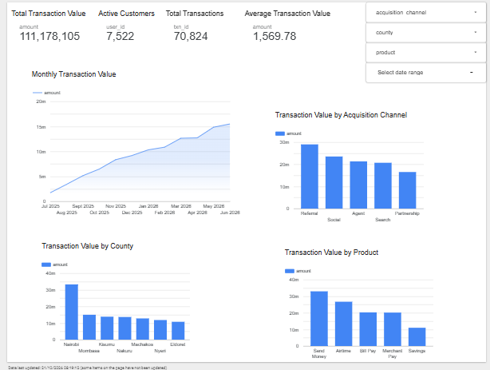

# PesaPap Customer Growth, Retention and Value Analytics

## End-to-End Data Analytics Capstone

**Track:** B - Fintech / Mobile Money  
**Author:** Robin Kinyua  
**Programme:** PLP Data Analytics  
**Date:** October 2026

## Business Problem

PesaPap is a simulated fintech and mobile money platform. The company has acquired thousands of customers, but the growth team needs to understand which acquisition channels generate the strongest customers, which products and counties contribute the most value, how customer activity changes after signup, and which customer groups should receive retention or reactivation attention.

### Stakeholder

The primary stakeholder is the **Head of Growth at PesaPap**.

### Decision

The analysis supports the following decision:

**Where should PesaPap focus acquisition, retention and customer engagement efforts to improve customer value and long-term activity?**

### Analytical Questions

1. Which acquisition channels generate the highest customer and transaction value?
2. Which products contribute the most transaction volume and value?
3. Which counties generate the highest total value and value per customer?
4. Which customer segments contribute the most value and which groups need reactivation or engagement support?
5. How does customer activity change over time after signup?

### Success Criteria

The project is successful if it:

- produces a reproducible cleaned dataset and documented cleaning log;
- answers at least five business questions using SQL and Python;
- calculates clearly defined growth, activity and value KPIs;
- identifies meaningful customer segments and retention patterns;
- provides an appropriate statistical test with correct interpretation;
- produces a stakeholder-friendly dashboard, Excel summary and executive report;
- gives clear and actionable recommendations to the Head of Growth.

## Project Overview

This project demonstrates an end-to-end analytics workflow covering data generation, data-quality auditing, reusable cleaning, exploratory data analysis, SQL, statistical testing, cohort analysis, dashboarding and stakeholder reporting.

## Data Source

This project uses a fully synthetic PesaPap fintech dataset generated specifically for the PLP Data Analytics capstone using:

`data/generate_capstone_data.py`

The generator uses random seed **808** for reproducibility.

**Data source:** Project-generated synthetic data  
**Licence:** Educational synthetic data; no external dataset licence applies  
**Date created/accessed:** October 2026  
**Analysis period:** July 2025 to June 2026

Further documentation is available in:

`data/README.md`

## Key Findings

- Total registered customers: **8,000**
- Customers with at least one valid transaction: **7,522**
- Ever-active rate: **94.02%**
- Total valid transactions: **70,824**
- Total transaction value: **KES 111,178,105**
- Average transaction value: **KES 1,569.78**
- Average customer value: **KES 13,897.26**
- Referral generated approximately **KES 29.03 million**
- Send Money generated approximately **KES 32.98 million**
- High Value customers contributed approximately **68.95%** of transaction value
- **478 customers** were inactive
- The July 2025 cohort declined from approximately **66.0% active in month 0 to 32.1% by month 11**

## Statistical Evidence

A Mann-Whitney U test was used to compare customer value between Referral and Social customers.

### Hypotheses

**Null hypothesis (H₀):** Referral and Social customers have the same distribution of customer value.

**Alternative hypothesis (H₁):** Referral and Social customers have different distributions of customer value.

### Result

- Mann-Whitney U statistic: approximately **1,945,284**
- p-value: approximately **6.24 × 10^-8**
- Significance level: **0.05**

Because the p-value is below 0.05, the null hypothesis is rejected.

Referral customers have a median customer value of approximately **KES 13,212.50**, compared with approximately **KES 11,084.50** for Social customers.

Because this project uses synthetic data and the generator intentionally applies slightly different engagement probabilities by acquisition channel, this result demonstrates the statistical method rather than proving a real-world causal relationship.

## Recommendations

1. Prioritise Referral acquisition while also measuring acquisition cost and scalability.
2. Protect and reward High Value customers because they contribute most transaction value.
3. Target Low Activity customers with engagement campaigns.
4. Develop reactivation campaigns for inactive customers.
5. Promote Send Money while testing cross-sell opportunities.
6. Explore high-value counties such as Nyeri, Nakuru and Machakos.
7. Introduce lifecycle retention campaigns several months after signup when cohort activity begins to weaken.

## Business Impact

If applied to real operational data, these recommendations could help PesaPap improve customer retention, increase transaction frequency, increase customer lifetime value, identify stronger acquisition channels, improve the efficiency of acquisition spending, and target engagement and reactivation campaigns more effectively.

## Dashboard

### Live Looker Studio Dashboard

https://datastudio.google.com/reporting/88c76eb4-bf90-4299-aa75-db02ccf89b44

### Static Dashboard

`reports/dashboard.png`

## Reports

The required stakeholder deliverables are available at:

- Executive summary: `reports/executive_summary.md`
- Dashboard image: `reports/dashboard.png`
- Dashboard data: `reports/dashboard_data.csv`
- Stakeholder Excel summary: `reports/stakeholder_summary.xlsx`
- Presentation slides: `reports/slides.pdf`

## Tools Used

- Python
- pandas
- NumPy
- Matplotlib
- SciPy
- SQLite
- SQL
- openpyxl
- Google Colab
- Looker Studio
- Microsoft Excel
- Git
- GitHub

## Repository Structure

plp-capstone-B-robin-kinyua/

- `README.md`
- `requirements.txt`
- `.gitignore`
- `data/`
  - `README.md`
  - `generate_capstone_data.py`
  - `users.csv`
  - `transactions.csv`
  - `campaigns.csv`
  - `activity.csv`
  - `processed/`
    - `users_clean.csv`
    - `transactions_clean.csv`
    - `campaigns_clean.csv`
    - `activity_clean.csv`
    - `cleaning_log.csv`
- `src/`
  - `cleaning.py`
- `notebooks/`
  - `01_cleaning.ipynb`
  - `02_eda.ipynb`
  - `03_analysis.ipynb`
- `sql/`
  - `queries.sql`
- `reports/`
  - `executive_summary.md`
  - `stakeholder_summary.xlsx`
  - `dashboard.png`
  - `dashboard_data.csv`
  - `slides.pdf`

## How to Run

Clone the repository:

`git clone https://github.com/robyke/plp-capstone-B-robin-kinyua.git`

Enter the project folder:

`cd plp-capstone-B-robin-kinyua`

Install the required libraries:

`pip install -r requirements.txt`

Run the notebooks in this order:

1. `notebooks/01_cleaning.ipynb`
2. `notebooks/02_eda.ipynb`
3. `notebooks/03_analysis.ipynb`

The first notebook generates the synthetic raw data, performs the six-dimension quality audit, applies the reusable cleaning pipeline, saves the processed files and loads the clean tables into SQLite.

## Reproducibility

The synthetic data generator uses random seed **808**.

Verified results:

- Raw transactions: **70,828**
- Clean transactions: **70,824**
- Unique clean transaction IDs: **70,824**
- Total cleaned transaction value: **KES 111,178,105**
- Average transaction value: **KES 1,569.78**
- Active customers: **7,522**

The notebooks are designed to run sequentially:

`01_cleaning.ipynb` → `02_eda.ipynb` → `03_analysis.ipynb`

## Ethics and Privacy Statement

The dataset is fully synthetic and does not represent real PesaPap customers.

The project contains no real names, phone numbers, email addresses, national identification numbers, account numbers or precise personal locations.

`user_id` is a pseudonymous synthetic identifier.

Individual-level customer records are not displayed on the published dashboard. Dashboard and executive outputs use aggregated results so individuals cannot be identified.

Additional ethics and privacy documentation is provided in:

`data/README.md`

## Limitations

The project uses synthetic data, so the findings demonstrate analytical methods rather than actual PesaPap business performance.

The generator intentionally applies different engagement probabilities across acquisition channels, meaning some acquisition-channel differences are built into the simulated data.

The project does not include real acquisition costs, customer profitability, competitor activity or wider economic conditions.

The **94.02% active rate** represents customers who completed at least one transaction during the full observation period. It should not be interpreted as current-month active users.

Monthly transaction growth is influenced by the expanding customer base and different observation periods for different signup cohorts.

The statistical test identifies an association between acquisition channel and customer value but does not establish causation.

## Author

**Robin Kinyua**

GitHub: **robyke**

Repository:

https://github.com/robyke/plp-capstone-B-robin-kinyua
